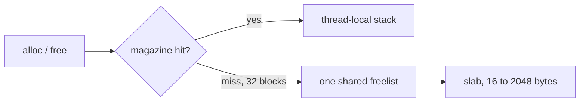

# Thilak Shekhar Shriyan

I write Rust for the path that has to stay correct while it is fast. Allocators, logs, lock-free structures, and the tail of a latency distribution.

```rust
/// What the recent crates are actually about.
pub enum Work {
    /// Slab, thread cache, shared freelist. A miss refills 32 blocks.
    Alloc,
    /// Bounded queue and an epoch collector. The hit path takes no mutex.
    Publish,
    /// Page cache and a write-ahead log. Group the commit, then sync.
    Durability,
    /// Evict for the p99, not the mean.
    Tail,
}

impl Work {
    pub const fn open() -> &'static [Self] {
        &[Self::Alloc, Self::Publish, Self::Durability, Self::Tail]
    }
}
```

Safe Rust owns the algorithm. `unsafe` is the slab backing store, the queue slot, the retired map node, and a Metal timestamp. Each of those sites says which invariant makes it sound.



## crates

**[memallocator](https://github.com/ThilakShekharShriyan/memallocator)**
A slab allocator with a thread-local magazine, a lock-free queue, two maps, an epoch collector, a page cache with a write-ahead log, and a Metal suballocator. Eight threads allocate and free 64-byte blocks, then the program prints where the time went.

**[BlitzLog](https://github.com/ThilakShekharShriyan/BlitzLog)**
A compressed log engine. Delta and varint encoding, SIMD scans, a write-ahead log, and Raft when the log has to live on more than one machine.

**[p99-edge-cache](https://github.com/ThilakShekharShriyan/p99-edge-cache)**
A chunk-cache simulator. LRU and LFU against a policy that evicts from the tail. The longer sweep is [CCNFinalAssignment](https://github.com/ThilakShekharShriyan/CCNFinalAssignment).

## same questions, other languages

**[PlayFlow](https://github.com/ThilakShekharShriyan/PlayFlow)** is a Go payment ledger: double-entry, exactly-once, from authorization through refund.

**[EmbedBase](https://github.com/ThilakShekharShriyan/EmbedBase)** is a Go vector index you can embed: HNSW, BM25, and a write-ahead log.

<details>
<summary>everything else</summary>

Federated learning and agents: [FlowerHackathon](https://github.com/ThilakShekharShriyan/FlowerHackathon), [flower-grid-observability-demo](https://github.com/ThilakShekharShriyan/flower-grid-observability-demo), [akash-autopilot](https://github.com/ThilakShekharShriyan/akash-autopilot), [GeoScale](https://github.com/ThilakShekharShriyan/GeoScale).

Apps: [LecRef](https://github.com/ThilakShekharShriyan/LecRef), [link-road](https://github.com/ThilakShekharShriyan/link-road), [AlmaProject](https://github.com/ThilakShekharShriyan/AlmaProject), [GameScroll](https://github.com/ThilakShekharShriyan/GameScroll).

Notes and older builds: [TILUDistributedSystems](https://github.com/ThilakShekharShriyan/TILUDistributedSystems), [MiniMicroServices](https://github.com/ThilakShekharShriyan/MiniMicroServices), [GoLLMServe](https://github.com/ThilakShekharShriyan/GoLLMServe), [Neetcode](https://github.com/ThilakShekharShriyan/Neetcode).

</details>

San Jose · [thilakshekharshriyan@gmail.com](mailto:thilakshekharshriyan@gmail.com) · [LinkedIn](https://www.linkedin.com/in/thilakshekharshriyan)
